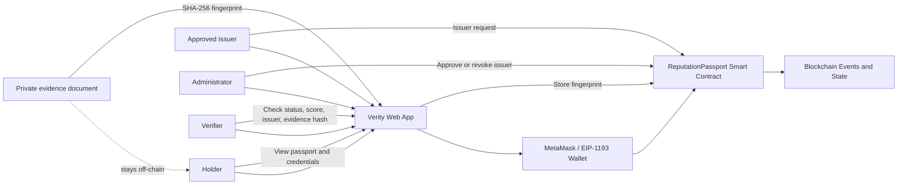

# Dynamic Soulbound Reputation NFT System

## Verity Reputation Passport — Project Report

**Submission due:** 29 October 2026, 11:59 p.m.

## Project Title

Dynamic Soulbound Reputation NFT System — Verity Reputation Passport

## Team Members

| Name | Registration number |
|---|---|
| Sarvesh M | 25BCE5743 |

## Problem Definition

Achievements are spread across certificates and institutional platforms. Verifiers must check multiple sources, and digital credentials can be forged, lost, or presented without a clear way to confirm whether they remain valid. This makes reputation difficult to carry across organizations.

The project provides a wallet-bound passport where approved issuers publish credentials and verifiers check issuer, status, score, dates, and an evidence fingerprint. Expired or revoked credentials remain in the audit history but stop contributing to the active reputation score.

## Need for Blockchain

A shared EVM ledger gives holders, issuers, and verifiers a common record without requiring them to rely on one institution's private database. Smart-contract rules limit credential issuance to approved issuers, prevent passport transfers, and make changes auditable. Sensitive evidence files remain off-chain; the contract stores their SHA-256 fingerprints.

## YouTube Upload Link

[Open the supplied project video folder on Google Drive](https://drive.google.com/drive/folders/18jxKCzcWXNWjWrzOdhO5aMobkRxYMCjP?usp=sharing)

## Project Launch Link

**Public launch:** [https://credsoul.vercel.app](https://credsoul.vercel.app)

Deployment status checked 2 Nov 2026: frontend reachable; smart contract currently reports “Contract not loaded.”

## Softwares Used

- Solidity and OpenZeppelin Contracts for the smart contract
- Hardhat for compilation, local blockchain development, and contract tests
- Vite and JavaScript for the frontend
- ethers.js for wallet and contract interaction
- MetaMask as the EIP-1193 wallet
- Clerk.js for account authentication
- Node.js and npm for the development environment

## AI Models Used

- ChatGPT Luna 6

## Detailed Architecture Diagram

## Components of Blockchain and Explanation on the Smart Contract Used

The system uses an EVM-compatible blockchain, a Solidity smart contract, wallet signatures, and contract events. The wallet identifies the account authorizing an action. The contract checks permissions and stores passport and credential state. Events provide an audit trail for important changes.

The `ReputationPassport` contract provides these main functions:

- `createProfile()` creates one non-transferable passport for a wallet.
- `createProfileFor(recipient)` lets an approved issuer create a passport for a student.
- Issuer request and approval functions let the administrator manage who can issue credentials.
- `issueCredential()` records a credential's issuer, recipient, category, score, dates, and evidence hash.
- `revokeCredential()` revokes a credential while retaining its history.
- `isCredentialActive()` checks whether a credential is currently valid.
- `reputationScore()` and `categoryScore()` calculate reputation from active credentials.
- `verifyEvidence()` compares an evidence fingerprint with the value recorded on-chain.

The contract blocks duplicate passports and credential transfers. Expiry and revocation remove a credential's points from active reputation while preserving its history.

## Sample Screenshots

Use Demo mode in the live web interface to capture these sample views:

1. Passport dashboard with sample score and identity card
2. Credential list showing active, expired, and revoked states
3. Issuer console showing the credential issuance workflow
4. Credential verification result showing issuer, status, and evidence hash

The current production frontend does not have a contract configured. Screenshots should show demo data and must not imply successful public-chain transactions.

## Conclusion

The project demonstrates a wallet-bound, non-transferable reputation passport with issuer-controlled credentials and expiry-aware scoring. On-chain records make credential status and history verifiable, while evidence files remain off-chain. The frontend is publicly reachable; completing live-chain verification requires deploying the contract to a public network and updating the frontend configuration.

## Verification

Solidity compilation, all 17 contract tests, and the Vite production build passed. The production build emitted a large JavaScript chunk warning but completed successfully.
